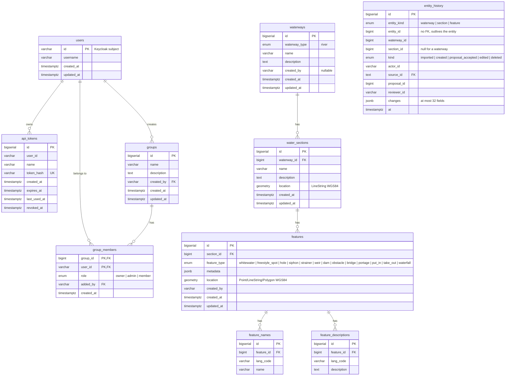

# Paddlemate

Platform for managing whitewater rivers, sections, and features.

## Database Schema

## History and sources

Every river, section and feature has a history: one step per change, oldest
first. All five routes are public, like the entries themselves.

| Route | Returns |
|---|---|
| `GET /waterways/{id}/history` | steps of the river, also after it was deleted |
| `GET /waterways/{id}/sections/{section_id}/history` | steps of the section, also after it (or its river) was deleted; `?include_features=true` adds `features`, feature id to that feature's page (same `page`/`per_page`, as its own route returns it) for the live and the deleted features of this section, at most 500 in all (lowest ids first); `features_truncated` is `true` when more were left out |
| `GET /waterways/{id}/sections/{section_id}/features/{feature_id}/history` | steps of the feature, also after it (or its section or river) was deleted |
| `GET /waterways/{id}/sections/{section_id}/deleted-features` | features deleted from the section, newest deletion first, each with its last name and type, when, by whom (and the proposal and reviewer, if one did); also after the section (or its river) was deleted, until the year is up; paged like the history routes. No screen uses it now (deleted features are hidden in the app); it stays as part of the public API |
| `GET /waterways/{id}/sources` | every source (with its step count) and contributor (with step count and last step) for the river, its sections and features; `?section_id=` narrows both to that section and its features (404 when the section is not in this river); readable after the river was deleted |

A deleted entity keeps its history under the path it had; the entity itself
answers 404. An id that never existed under that path, or exists under another
parent, answers 404. Deleting a river or section writes a `deleted` step for
each section and feature that goes with it. The app reads a removed feature's
history from the feature route above with the ids it still holds.
The `sources` view needs a live river.

History routes page with `page` and `per_page` (default 50, max 100) and
return `items`, `page`, `per_page`, `total`, `total_pages` (schema `PaginatedResponse_for_HistoryStep`). A step has `kind`
(`imported`, `created`, `proposal_accepted`, `edited`, `deleted`), `at`,
`actor` and `reviewer` (id and username only), `source` (imports),
`proposal_id`, `proposal_note` (the submitter's note on that proposal, if any)
and `changes`, a list of `{field, before, after}` as short
display strings. A geometry change is `location` with null values. A deleted
entity by an accepted proposal is a `deleted` step that also carries
`proposal_id` and `reviewer`.

Proposals: the create and update routes for rivers, sections and features take
an optional `proposal_note` next to the usual fields (trimmed, at most 500
characters, 400 with target `proposal_note` when longer; ignored when an admin
applies the change directly). It is stored on the proposal as `submitter_note`
and returned wherever the proposal is, so it is readable by whoever may read
the proposal, and by anyone in the history step of an accepted one. Delete
proposals take no body and so no note.

Region outlines: `GET /geo/region-outlines?bbox=` takes an optional `kinds`
(comma list of `valley`, `district`, `range`, `state`; anything else is a 400
with target `kinds`). Each requested kind comes back only while the viewport is
no wider than its limit (valley 3, district 6, range 8, state 12 degrees); a
kind past it is named in `hidden_kinds`. Without `kinds` one kind is chosen by
the viewport width. At most 120 outlines per kind (300 for ranges).

Ground the server has not stored yet is fetched from OSM in the background,
at most 32 tiles at once across all callers. When that queue is full a request
claims nothing and still answers `filling: true`, so the client asks again.

Regions: `q` is at most 100 characters and `country` a two letter code (400
with that target otherwise). `GET /geo/regions?q=` results carry `parents`, the regions each one
lies in (district, state, country; a range lists only its country), found by
containment of a point on the region, at most one per kind. The `countries`
of `GET /geo/region-outlines` carry `neighbours`, the ISO codes of the other
imported countries whose area comes within about a kilometre of the clipped
border line, so the map can label a line "AT | IT".

Errors: a query string, path or body that axum rejects before a handler runs
(`GET /geo/region-outlines` without `bbox`, `?page=abc`, `?kind=bogus`) comes
back as the usual envelope, 400 with code `validation_failed`, through the
`envelope_rejections` layer. `target` is set when the rejection names a field.

Children are looked up inside their parents: a feature id reached through
another section's path answers 404. Source ids are strings, as in the `sources`
table.

Steps are written in the same transaction as the change: admin creates, edits
and deletes (including the translation endpoints, which are admin-only), and accepted proposals (the actor is the submitter, the reviewer
is the admin who approved). An edit that changes nothing writes no step. Old
rows got a first step by migration `0048`: `imported` (source Rivermap) for
rows the Rivermap importer made, else `created`. Not recorded: the bulk import
binaries.

Other limits worth knowing: names (translations, descents) are at most 255
characters and translated descriptions 10000; descent coordinates are range
checked; `GET /users` and `GET /proposals` return the paged envelope (`page`, `per_page`, at
most 100, default 100; `GET /users` also takes `q`); comment edits, deletes and
moderation are looked up inside the river, section and feature of their path;
votes need a pending proposal (409 otherwise) and never come from its author (403); a group's owner role cannot be
changed or overwritten; photo uploads accept up to 8 MB (the body limit of
those routes is raised to match).

Retention: history is the audit trail and is kept for as long as the data. When
an entity is deleted its history stays readable for one year
(`KEEP_DELETED_DAYS`, 365), then a daily task (`history::run_pruner`, 5 minute
timeout, batches of 200 entities) removes all its steps; a section or river
delete counts for each child it took along. History of live entities is never
pruned. There is no cascade from the entity; each step is bounded as well (32
fields, 200 characters per field name or value).

Proposal responses carry `submitted_by_name` and `reviewed_by_name`.

## Batch reads

Screens that show many rivers or sections ask once instead of once per row.
Each takes at most 100 comma separated ids and answers 400 for an empty or
malformed list or more than 100; repeated ids count once, unknown ids are
absent (or have an empty `ranges`).

| Route | Returns |
|---|---|
| `GET /waterways?ids=1,2,3` | the list route, only these rivers, all on page one; other filters still narrow. `&include_sections=true` adds each river's `sections` as `GET /waterways/{id}` returns them (400 without `ids`) |
| `GET /waterways/water-status?section_ids=1,2,3` | object keyed by section id, each value what `.../sections/{id}/water-status` returns |
| `GET /waterways/{id}/sections/{section_id}/history?include_features=true` | see History and sources |

## Gauge readings

`GET /api/v1/waterways/gauges/{gauge_id}/series/{series_id}/readings/summary`
returns about `points` values for any range, for charts.

| Query | Meaning |
|---|---|
| `from`, `to` | ISO 8601 UTC. `to` defaults to now, `from` to `to` minus 7 days. `from` must be before `to` and the span at most 1831 days (five calendar years always fit), else 400 |
| `points` | Target count, default 300, clamped to 10..1000 |

Response: `{ bucket_seconds, from, to, items: [{ measured_at, value, min, max, count }] }`,
oldest first. When the range holds at most `points` readings, `bucket_seconds`
is 0 and each item is one raw reading (`min = max = value`, `count = 1`).
Otherwise the span divided by `points` is rounded up to one of 60, 300, 900,
1800, 3600, 7200, 10800, 21600, 43200, 86400, 172800, 259200 or 604800 seconds
(the last when none fits). Buckets are aligned with `date_bin` to 1970-01-01;
`measured_at` is the bucket start, `value` the average. Empty buckets are left
out. 404 when the series is not on that gauge. The query is an index-only scan
on `idx_gauge_readings_series_time_value`; code in
`src/query/gauges/summary.rs` and `src/routes/gauges/summary.rs`.
`.../readings` (newest first, at most 1000) is unchanged.

## Authentication

Two authentication methods are supported:

- **Keycloak JWT** - Bearer token via `Authorization` header
- **API Token** - `X-Api-Key: pm_<token>` header

Server admin privileges are granted via the `server_admin` Keycloak realm role.

## Keycloak Setup

The API requires two Keycloak clients in your realm.

### `paddlemate-web` (public OIDC client)

Used by the frontend for PKCE login.

1. Create a client with **Client authentication** OFF (public)
2. Enable **Standard flow**
3. Set redirect URIs and web origins to your frontend URL

### `paddlemate-api` (service account client)

Used by the API backend to look up usernames via the Keycloak Admin REST API.

1. Create a client with **Client authentication** ON (confidential)
2. Enable **Service accounts roles** - this grants the `client_credentials` flow
3. Go to the **Service accounts roles** tab → **Assign role**
   - Change filter to **"Filter by clients"**
   - Search for `realm-management` and assign the **`view-users`** role
4. Copy the client secret from the **Credentials** tab into `KEYCLOAK_CLIENT_SECRET` in `.env`

